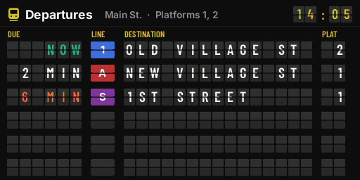
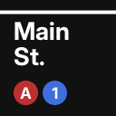
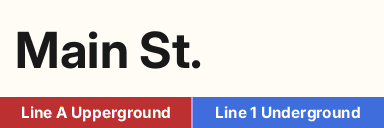
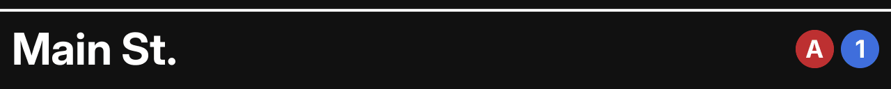
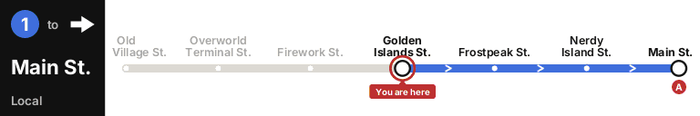
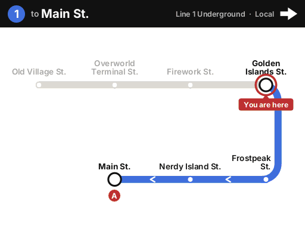
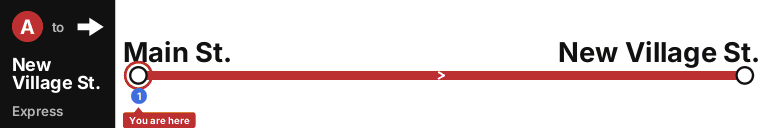

# Displays and the wand

--8<-- "README.md:displays"

## What each display looks like

Samples rendered from a real network, in the map colours an item frame shows
(`./gradlew generatePreviews` makes them):

| Board, two by one | Station sign, one frame | Station sign, Hong Kong style |
|---|---|---|
|  |  |  |

| Network map | Status panel |
|---|---|
|  |  |

**Board** - an airport's split-flap board: a heading with the station, the platforms and the
time, column titles in amber, then one row of flaps per departure: the minutes to go (or NOW),
the line on a flap in its colour, the destination, the platform and a remark (BOARDING, ARRIVING,
DELAYED, SUSPENDED). Columns appear as the board gets wider; on a narrow board the time takes the
remark's colour. When the departures change, the flaps turn through the alphabet to the new ones
for about a second; `displays.board-animation: false` changes them at once. A board shows the
minutes, so it changes about once a minute per departure, and only while a player is within 96
blocks.

**Roadmap** - the diagram of one service: a black heading with the route bullet, where the train
goes and the line and service, then the line in its colour with every stop. The stations the train
has already passed are grey, the station the display hangs at has a red ring and "You are here",
interchanges carry the bullets of the other lines, and white chevrons point the way the train
goes. A loop runs on past its last stop with "then" and its first. `left` or `right` after the
station draws trains leaving that way. The frames decide the shape unless you say: three or more
times as wide as high is one strip (with the heading as a panel at the end on a single row of
frames), a landscape wall folds the line into rows that turn at the ends, a square or upright sign
is a column of stops; `strip`, `rows` or `column` sets it.

**Station sign** - the station's name with the lines that call there. New York style (the
default, `displays.sign-style`) is white on black under a white stripe with the route bullets;
Hong Kong style is dark on white over a band of the line colours, each part named where it fits.
Text after the station (and the style) is a smaller line under the name. A `logos/<station>.png`
of yours is shown instead, with the name under it.

**Map** - the network drawn along the recorded track, north up, scaled to fit the frames, with
interchanges and termini named and the station you give marked in red. `/atcs map` hands out the
same picture as a map item that shows where its holder is; every copy shares one map.

**Status** - every line with its badge and *Good service* or its suspension notice.

**Hologram** - a floating departure board on a text display entity: the station and platform as a
header, then one departure per line, in the line colours, readable from far away. The layout is
in `messages.yml` under `hologram:`; `displays.hologram.departures`, `scale` and `see-through` are
in `config.yml`. It faces the way you looked when you placed it, squared to the walls, and stays so;
`/atcs display face <id>` turns it to face you again (a hologram placed by an older version turns to
each player until you do). It is saved with the chunk, so it is still there after a restart; ATCS
puts it back if someone removes the entity.

## Frames

Any item frames, including glow item frames, in a full rectangle on one wall. ATCS reads the
frames off the wall as a viewer sees them: the frame at the viewer's top left becomes the top-left
tile. One frame is 128 by 128 pixels; the picture is rendered at the mosaic's size, so a row of
four frames is a 512 by 128 picture. Frames on a floor or ceiling are refused.

While a display is shown its frames are fixed: players cannot rotate the map or take it out
(`displays.fix-frames: false` leaves them as they were). `/atcs display remove` empties the frames
and unfixes them. The maps are ordinary Minecraft maps with ATCS as their only renderer; they are
not saved as pictures, so a map taken out of a frame is blank until ATCS draws it again, which it
does whenever the display exists in `network.yml`. `/atcs display export <id>` saves what a display
shows as `exports/<id>.png` in the plugin's folder, to check one from afar or share it.

## Footprints and bulk binding

With the station's footprint set, `/atcs station here` knows where you are without a sign nearby,
and only that station's platforms are considered. BlueMap draws the footprint as a translucent box
in the line colour. Footprints must not overlap.

`/atcs station bindall <station> [platform]` binds every unbound TrainCarts station sign in the
selection: each sign becomes its own platform, numbered on from the existing ones, unless you name
one platform for all of them. `/atcs station convert` can then turn them into `atcs station` signs.
