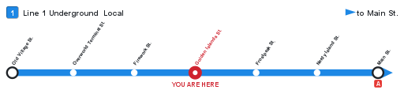
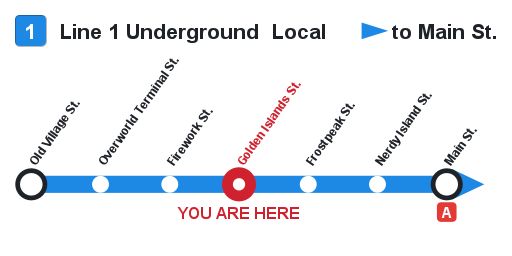
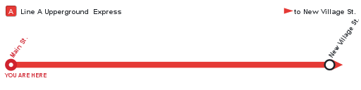
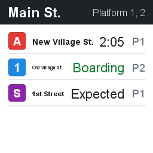
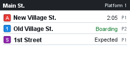
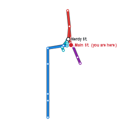
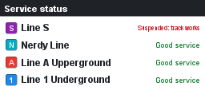
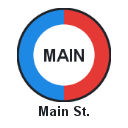

# Displays and the wand

--8<-- "README.md:displays"

## What each display looks like

Samples rendered from a real network (`./gradlew generatePreviews` makes them):

| Board, two by two | Board, two by one |
|---|---|
|  |  |

| Network map | Status panel | Logo |
|---|---|---|
|  |  |  |

**Roadmap** - the strip diagram of one service: a header with the line badge, the line and
service names and the destination with an arrow, then the line in its colour with every stop. Stops
the service runs through are small ticks with muted names, interchanges carry the badges of the
other lines below the line, the ends are ringed, and the station the display hangs at is a red
"YOU ARE HERE". Names run diagonally so a long line fits a row of four frames; give it two rows
when names are long.

**Logo** - the station's roundel (or your `logos/<station>.png`) with the station's name under it.

**Board** - a dark header with the station name and the platforms, then one row per departure:
line badge, destination, the countdown (or *Boarding*, *Arriving*, *Expected*, *Suspended*) and
the platform. It is drawn again whenever a departure changes, at the boards' refresh rate.

**Map** - the network drawn along the recorded track, north up, scaled to fit the frames, with
interchanges and termini named and the station you give marked in red. `/atcs map` hands out the
same picture as a map item that shows where its holder is; every copy shares one map.

**Status** - every line with its badge and *Good service* or its suspension notice.

**Hologram** - a floating departure board on a text display entity: the station and platform as a
header, then one departure per line, in the line colours, readable from far away. The layout is
in `messages.yml` under `hologram:`; `displays.hologram.departures`, `scale` and `see-through` are
in `config.yml`. It turns to face you and is saved with the chunk, so it is still there after a
restart; ATCS puts it back if someone removes the entity.

## Frames

Any item frames, including glow item frames, in a full rectangle on one wall. ATCS reads the
frames off the wall as a viewer sees them: the frame at the viewer's top left becomes the top-left
tile. One frame is 128 by 128 pixels; the picture is rendered at the mosaic's size, so a row of
four frames is a 512 by 128 picture. Frames on a floor or ceiling are refused.

While a display is shown its frames are fixed: players cannot rotate the map or take it out
(`displays.fix-frames: false` leaves them as they were). `/atcs display remove` empties the frames
and unfixes them. The maps are ordinary Minecraft maps with ATCS as their only renderer; they are
not saved as pictures, so a map taken out of a frame is blank until ATCS draws it again, which it
does whenever the display exists in `network.yml`.

## Footprints and bulk binding

With the station's footprint set, `/atcs station here` knows where you are without a sign nearby,
and only that station's platforms are considered. BlueMap draws the footprint as a translucent box
in the line colour. Footprints must not overlap.

`/atcs station bindall <station> [platform]` binds every unbound TrainCarts station sign in the
selection: each sign becomes its own platform, numbered on from the existing ones, unless you name
one platform for all of them. `/atcs station convert` can then turn them into `atcs station` signs.
