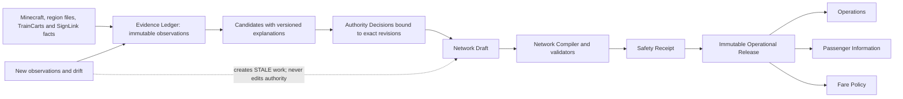

# AdvancedTrainControlSystem Audited Architecture and Delivery Roadmap

**Status:** Audit reference; the clean-development update below supersedes its migration assumptions  
**Audit date:** 2026-08-08  
**Workspace:** `C:\Users\jason\Documents\AdvancedTrainSys`  
**Target runtime:** Paper 1.21.11, Java 21, TrainCarts 2.0.0, BKCommonLib 2.0.1, SignLink 1.21.5-v1  
**Independent plan review:** PASS, 8.9/10

## Implementation direction update — 2026-08-08

The user confirmed that ATCS is still pre-production and staging data is disposable. The implementation therefore uses a clean reset instead of building V008 data-preservation migrations or legacy backfills:

- delete only the disposable ATCS plugin data directory, deploy the new JAR, and restart;
- let the existing V001–V007 bootstrap create a fresh database, without adding a new migration for old prototype data;
- use TrainCarts' `enabledWorlds`/`disabledWorlds` behavior as the sole runtime world boundary;
- consider only loaded worlds for which `TrainCarts.isWorldDisabled(world)` is false;
- do not give `old_world` or any other world special ATCS configuration or mutation behavior;
- keep inactive/unloaded-world records filtered and unchanged rather than converting them to `ARCHIVED`;
- continue through tested implementation slices without stopping automatically at Phase 0.

Sections below that require V008 backfill, retention of the old staging database, or an ATCS-specific active/archive world policy are retained only as audit history and are not current implementation requirements.

## 1. Executive decision

ATCS has a credible physical-evidence and administration prototype, but it is not yet a safe operational railway-control system. The evidence foundation is worth preserving. The current form-driven domain layer, direct SQL-backed web mutations, custom Anvil parser, and mixed Evidence/Network interface are not suitable foundations for live control, passenger information, or fares.

The correct starting point is:

1. Establish a governed, reproducible baseline and recoverable database process.
2. Build an additive, immutable Evidence Ledger with decisions bound to exact observation revisions.
3. Put the Anvil reader behind a bounded hostile-input parser and define Paper-safe snapshot semantics.
4. Enforce application/domain boundaries before expanding the UI or adding operational features.

Do **not** start by extending the current fare forms, drawing approved lines over the current physical map, or enabling TrainCarts/SignLink writes. Those depend on trustworthy evidence, a validated Network model, and immutable Operational Releases.

### Recommended first implementation slice

After Phase 0 approval, implement Phase 1A–1B only:

- add the V008 evidence-revision schema without changing V001–V007;
- capture immutable sign observations;
- bind INCLUDE/IGNORE decisions to a specific observation revision;
- mark a decision stale when the observed sign content changes;
- prove the behavior with migration, repository, and staging reconciliation tests.

Stop at that acceptance gate before beginning the parser rewrite.

## 2. Planning-readiness assessment

This score measures whether the handover is defined well enough to make an audited roadmap. It is **not** a production-readiness score.

| Dimension | Score | Maximum | Basis |
|---|---:|---:|---|
| Problem definition | 27 | 30 | Safety intent and current failure modes are explicit. |
| Scope and boundaries | 18 | 25 | Major modules and exclusions are known; detailed operational policy is not. |
| Success criteria | 18 | 20 | Strong discovery and safety constraints; later service/fare policy is incomplete. |
| Technical constraints | 14 | 15 | Runtime versions, archive behavior, portability, and language are fixed. |
| Phase decision | 9 | 10 | Architecture approval is explicitly required before implementation. |
| **Total** | **86** | **100** | Above the 80-point threshold for planning without blocking clarification. |

## 3. Fixed requirements and non-negotiable invariants

- Target Paper 1.21.11 and Java 21 exactly.
- Integrate against TrainCarts 2.0.0, BKCommonLib 2.0.1, and SignLink 1.21.5-v1.
- Keep all code comments, UI text, announcements, and documentation in English.
- Keep the default theme light.
- Keep paths, world names, currency, ports, and operational identifiers configurable and portable.
- Keep `old_world` archive-only and disabled.
- Never turn a sign into a station automatically.
- Every newly observed sign begins pending. Only an explicit operator decision can include or ignore it.
- Reverse and re-acceleration/continue signs are Control Markers, not passenger stations.
- Rails without signs remain discoverable, queryable, and visible.
- Discovery must not generate chunks, complete chunks, or modify world blocks.
- V001–V007 migrations are historical artifacts and must never be edited.
- Evidence is never overwritten by inference or approval.
- READ_ONLY and SHADOW modes perform no TrainCarts, SignLink, block, or world-control writes.
- No new feature phase begins until the preceding evidence package is approved.

## 4. Verified baseline

The following was checked read-only against the workspace and staging server.

| Area | Verified state |
|---|---|
| Build | Workspace JAR SHA-256 is `A583B92642FC2D69898DE6E6AFDF2B93395D9C7727809F5C7EA9E800A8122C0F`, matching the deployed artifact. |
| Tests | A fresh `test --rerun-tasks` run passed 41 tests in 22 suites with no failures, errors, or skips. |
| Java | Source/bytecode targets Java 21. The available development runtime appeared to be Java 24 and staging runs Java 25, so an actual Java 21 execution gate is still missing. |
| Runtime | Paper 1.21.11, TrainCarts 2.0.0, BKCommonLib 2.0.1, and SignLink 1.21.5-v1 are present; ATCS starts cleanly in READ_ONLY mode. |
| Web | Bound to `127.0.0.1:8765`; authenticated UI loads with no observed browser-console error. |
| Database | SQLite schema V007; `quick_check` is `ok`. |
| Rail evidence | Latest run completed 3,222/3,222 saved rail chunks, 116,584,448 block checks, 48,936 nodes, 39,718 edges, and 160 boundaries; no node cap. |
| Sign evidence | 221 inventory rows: 203 in active `world`, 18 in archived `old_world`; all 203 active signs are pending and there are no infrastructure decisions. |
| Approved domain | 0 stations, platforms, lines, route plans, gates, zones, rules, track nodes/segments, service patterns, trips, or receivers. |
| Archive isolation | `old_world` is configured as archive-only and absent from active staging discovery. |
| Audit/operations | 33 operational events and 1 audit record exist. |
| Source size | Approximately 14,733 relevant source/test/resource lines. `AdminDataRepository.java` is 1,835 lines and `app.js` is 1,008 lines. |

The handover's last TPS observation was 20.0/20.0/19.9. This was not treated as a sufficient performance benchmark; later phases require repeatable load evidence.

## 5. Audit findings

### 5.1 Blockers before feature expansion

| Finding | Evidence | Consequence | Required disposition |
|---|---|---|---|
| A changed sign can retain an old infrastructure decision. | `LegacySignInventoryRepository.java:112-176` resets legacy review fields when text changes but does not invalidate `infrastructure_symbol_decision`. | An approval can silently apply to evidence the operator never reviewed. | Replace with immutable observation revisions and revision-bound decisions in Phase 1. |
| The Anvil parser does not impose adequate file/sector/decompression/allocation bounds. | `SavedRailChunkLocator.java:81-144`; `AnvilRailExtractor.java:69-80`. | Corrupt or hostile region data can exhaust memory or be silently skipped. | Rewrite as a bounded streaming parser with quarantine and per-chunk results. |
| Unknown rail shapes are coerced to `NORTH_SOUTH`. | `AnvilRailExtractor.java:108-116`. | Unknown evidence becomes false topology. | Reject/quarantine unknown values; never coerce. |
| Direct web repository writes bypass domain invariants. | `ServiceCall.java:14` rejects zero dwell for PASS/NON_SERVICE, while `AdminDataRepository.java:1317` and V006 permit it. | API behavior can contradict the domain and preserve invalid derived state. | Route all mutations through application services and aggregates. |
| `continue`/re-acceleration signs can be inferred as passenger candidates. | `InfrastructureCandidateInference.java:195-213` excludes reverse early but matches continue later. | A track-control instruction can appear as a station candidate. | Classify Control Markers before any passenger-station inference. |

### 5.2 Architectural and operational findings

- V001 and V006 contain competing route/service concepts. The V001 authoritative model and V006 route-plan UI model must be consolidated behind a single Network aggregate rather than extended in parallel.
- Saved-region scanning does not define how dirty loaded chunks join the evidence run. Capture failures can still leave the overall run marked complete. A run needs explicit COMPLETE/PARTIAL/FAILED semantics and source provenance per chunk.
- Run-specific rail node IDs are not stable identifiers for long-lived routes or operational authority.
- SignLink is compiled and detected, but no functional display-intent/outbox/reconciliation integration exists. The `enabled` key is not read by the current plugin configuration path.
- Runtime capability gating checks dependency presence, not exact supported versions or adapter health.
- The HTTP layer is reasonable for a loopback prototype—random token/session/CSRF values, constant-time comparison, HttpOnly/SameSite cookies, CSP, and a body cap are present—but all sessions are SYSTEM_ADMIN, session/audit identity is weak, attempts and sessions are unbounded, request timeouts are incomplete, and non-loopback plaintext merely warns.
- The handover contains an administrative credential. It must be rotated before implementation and must not enter Git, logs, plans, screenshots, or test fixtures.
- The event publisher queue and request executor are unbounded; receiver state has no eviction; some transitions publish before durable persistence; shutdown stages are not independently guarded.
- `world` and `HKD` are embedded fallbacks in the API/UI/schema. The map's world selector is derived from symbol worlds, making a rail-bearing signless world unreachable.
- Current fares are raw database forms. They do not model hardware/policy separation, precedence, effective time, conflicts, simulation, publication, or rollback.

### 5.3 UI/UX audit

The live light-theme UI was inspected at 1280×720 and an effective 800×600 viewport across all six modules, the evidence inspector, map modes, and fare layout. The deterministic markup detector returned zero findings; that clean static result does not establish dynamic accessibility or workflow quality.

**Design health: 13/40 — Poor; major workflow redesign required.**

| Heuristic | Score |
|---|---:|
| Visibility of system status | 2/4 |
| Match to the real world | 2/4 |
| User control and freedom | 1/4 |
| Consistency and standards | 2/4 |
| Error prevention | 1/4 |
| Recognition rather than recall | 1/4 |
| Flexibility and efficiency | 1/4 |
| Aesthetic and minimalist design | 1/4 |
| Error recovery | 1/4 |
| Help and documentation | 1/4 |

The interface looks ATCS-specific, with credible rail language and a useful map/table/inspector foundation. Its behavior is still generic CRUD: evidence and authority are mixed; save/conflict recovery is transient; Lines and Fares overload the operator; the canvas is not keyboard-operable; micro-actions and tooltip-only audit details are inaccessible; and domain rules leak as IDs, enums, minor units, coordinates, and JSON.

Target administration structure:

1. Evidence
2. Network
3. Operations
4. Passenger Information
5. Fares
6. System Health

## 6. Keep, refactor, rewrite, and retire

| Decision | Components |
|---|---|
| **Keep** | SQLite with WAL and explicit transactions; pre-migration checkpoint/backup concept; core value objects; JDK HTTP server while loopback-only; direct TrainCarts registration pattern; the map/table/inspector visual foundation; preserved source text and explicit decision intent. |
| **Refactor** | Migration governance; sign scan lifecycle; discovery orchestration; HUD; web sessions; API errors/pagination; test harnesses; configuration; lifecycle/backpressure; runtime health. |
| **Rewrite** | Anvil parsing; candidate inference; route/application model; monolithic `AdminDataRepository`; direct route-chain HTTP mutations; SignLink integration; fare workflow. |
| **Retire after acceptance** | Current fare forms as design authority; unused V001 operational write paths and V004 seed paths; mutable v1 API operations; obsolete vendored 1.21.5 artifacts. Preserve historical tables/readers read-only until migration reconciliation is approved. |

## 7. Target architecture

Use a modular monolith inside the Paper plugin. A microservice split or frontend framework migration would add failure modes without solving the current domain problems.

### 7.1 Module ownership

| Module | Owns | May depend on |
|---|---|---|
| Evidence | Capture runs, observations, physical identities, candidates, revision-bound Authority Decisions, extraction issues | System Health ports only |
| Network | Network Drafts, stations, platforms, Control Markers, directed corridors/segments, lines, routes, compiler, Safety Receipts, Operational Releases | Evidence read contracts |
| Operations | Service patterns, trips, train/receiver state, replay, reconciliation, control intents | Published Operational Release only |
| Passenger Information | DisplayIntent, announcements, HUD, SignLink outbox/reconciliation | Published release and canonical trip state |
| Fares | Gate hardware register, placement, zones, rules, simulations, fare releases | Published Network identities; never raw evidence IDs |
| System Health | Runtime capability, configuration, migrations, backups, sessions/security, metrics, audit export | Module health contracts |

Application services own authorization, validation, transactions, audit records, and durable event publication. HTTP, Paper, SQLite, TrainCarts, and SignLink are adapters. Adapters must not contain domain rules or call each other's repositories.

### 7.2 State definitions

- **OBSERVED:** immutable fact captured from a named source in a named capture run.
- **PENDING:** current observation revision has no operator decision.
- **INCLUDED / IGNORED:** explicit Authority Decision for exactly one observation revision.
- **STALE:** a newer observation or dependency revision exists; the old decision remains historical but has no authority over the new revision.
- **DRAFT:** editable operator model that references included evidence and has not passed publication gates.
- **PUBLISHED:** immutable, validated Operational Release selected by one atomic current-release pointer.
- **ACTIVE:** control capability explicitly enabled for a compatible published release after shadow acceptance; never inferred from plugin startup alone.

### 7.3 Operational glossary

- **Stable physical identity:** a generated ATCS ID whose initial key uses world UUID, block coordinate, and sign face/rail anchor. Relocation creates a new identity; an explicit IdentityResolver action may link continuity. Proximity never merges assets automatically.
- **Active current sign:** the latest non-tombstone sign observation in a configured active world from a capture run whose chunk result is complete.
- **Exact dependency match:** the normalized runtime-reported Paper/plugin version equals its configured supported version. Unknown, missing, or mismatched versions disable the affected capability.
- **Healthy database:** expected schema range, successful `quick_check` and `foreign_key_check`, no incomplete migration lock, writable capacity above threshold, and successful required WAL checkpoint/recovery checks.
- **Useful local map:** the operator can select a component/corridor, view a bounded geographic region plus synchronized linear strip, and inspect every underlying observation without relying on a whole-world fit.

## 8. Data, event, and compatibility contracts

### 8.1 V008+ schema outline

The exact DDL is a Phase 1A deliverable, but ownership and relationships are fixed:

- `evidence_capture_run`: source, world UUID, parser/inference version, start/end UTC, source fingerprint, COMPLETE/PARTIAL/FAILED status, counts, and failure summary.
- `rail_chunk_observation`: run/world/chunk key, acquisition source (`SAVED_REGION` or `LIVE_SNAPSHOT`), source fingerprint, status, error/quarantine reference, and counts.
- `sign_observation`: immutable physical asset ID, revision, run, world UUID, coordinate/face, raw text/faces, content hash, observed UTC, and tombstone state.
- `physical_asset_identity` and `physical_asset_link`: stable identity and explicit continuity/alias decisions.
- `infrastructure_candidate`: exact observation revision, type, inference version, confidence, machine explanation, and review status.
- `authority_decision`: exact observation/candidate revision, INCLUDE/IGNORE, actor, reason, UTC, and supersession link. No decision row is updated in place.
- immutable rail graph generation tables keyed by capture run, with stable evidence references separated from run-local topology IDs.
- `network_draft`, typed Network asset tables, and provenance join rows referencing exact Evidence revisions.
- `operational_release`, versioned artifact payloads, validation results, dependency/config compatibility, Safety Receipt hash, and atomic current-release pointer.
- durable inbox/outbox and versioned audit-event tables for cross-module delivery and replay.

V001–V007 remain byte-for-byte unchanged. V008 backfills observations and pending state without interpreting records as approved authority.

### 8.2 Event envelope

Every durable domain event uses a versioned envelope:

`event_id`, `event_type`, `schema_version`, `aggregate_type`, `aggregate_id`, `aggregate_version`, `occurred_at_utc`, `actor_id`, `correlation_id`, optional `causation_id`, optional `operational_release_id`, and a typed payload.

Events and their outbox row commit in the same SQLite transaction. Consumers are idempotent by event ID and reject unknown major schemas. Audit events form a tamper-evident hash chain and support an English, redacted export.

### 8.3 Configuration and release compatibility

- Add a configuration schema version. Unknown safety-critical keys or a future schema fail closed; removed/deprecated keys produce actionable startup diagnostics.
- API v2 uses typed resources/errors, server pagination, and explicit world enumeration. V1 mutations are frozen and then removed after a documented compatibility window; read-only legacy views remain only as needed for reconciliation.
- Each binary declares the database-schema range, configuration-schema range, event major versions, and Operational Release artifact versions it can read.
- Startup refuses a database ahead of the binary or an incompatible current release. It never attempts a down migration.
- An Operational Release records the adapter/runtime compatibility against which it was validated.

### 8.4 Provisional retention policy

Until a signed policy replaces it, automatic deletion is disabled.

- Sign observations, Authority Decisions, audit events, and published releases: retain indefinitely.
- Rail graph generations: retain every generation referenced by a decision/release and at least the latest three complete generations; deletion of unreferenced generations requires an approved maintenance action.
- Parser quarantine: retain until classified and exported or deliberately purged with an audit record.
- Operational telemetry: propose 30 days detailed and 180 days aggregated in Phase 5; security events: propose 180 days. These numbers require Phase-gate approval before enforcement.
- Backups are access-restricted, never web-served, covered by the secret-handling policy, and pruned only under an approved capacity/retention policy.

## 9. Delivery roadmap

Relative size is `S` (one bounded change), `M` (several coordinated changes), or `L` (multiple vertical slices). Calendar estimates should be made only after Phase 0 produces a reproducible build and test-duration baseline.

### Phase 0 — Governed baseline and recovery (`M`)

**Ordered slices**

0A. Rotate the exposed admin credential; initialize Git after approval; exclude secrets, staging state, build/cache outputs, backups, and database copies; create an intentional baseline commit and artifact manifest.  
0B. Run build/test on an actual Java 21 runtime; pin wrapper/dependency verification; add exact Paper/plugin startup smoke testing and English-only scanning for CJK/non-allowlisted user-facing strings/comments.  
0C. Checkpoint WAL, create and hash a V007 clone, rehearse restore into an isolated location, record row counts/content hashes, and write migration/backup ADRs.  
0D. Write the threat model, data-retention proposal, configuration schema, runtime capability matrix, phase approval roles, and test-tooling ADRs.

**Acceptance gate**

- Java 21 build and all 41 existing tests pass reproducibly.
- Deployed/workspace hashes and exact runtime dependency versions are recorded.
- `quick_check`, `foreign_key_check`, table counts, and evidence hashes are recorded before and after a successful isolated restore.
- Active staging and `old_world` remain unchanged; secret scans find no credential in tracked/planned artifacts.
- Threat model covers HTTP exposure, privilege escalation, audit tampering, supply chain, backups, Paper thread affinity, disk pressure, time anomalies, and partial publish.
- Product/Safety Approver accepts the Phase 0 evidence package and residual risks.

### Phase 1 — Evidence safety ledger and parser airlock (`L`, recommended first code phase)

**Ordered slices**

1A (`S`). Approve V008 DDL, aggregate/event contracts, migration fixture, reconciliation query set, and rollback evidence.  
1B (`M`). Add immutable sign observations, stable physical identity, revision-bound candidate/decision rows, changed/deleted/stale semantics, and Control Marker-first classification.  
1C (`M`). Build a streaming Anvil parser with hard file/sector/compressed/decompressed/NBT depth/list/string/allocation/time limits, cancellation, unknown-value rejection, quarantine, and fuzz/property tests.  
1D (`M`). Prototype Paper-safe source union. Acquire supported immutable loaded-chunk snapshots on the main thread under a per-tick budget; never access Bukkit world/chunk objects asynchronously. Read saved region data off-thread. Verify region header/fingerprint before and after acquisition and retry or mark PARTIAL on a save race. A live snapshot supersedes saved evidence for the same chunk. If supported snapshot semantics cannot be demonstrated, stop and revise the design.  
1E (`S`). Add exact dependency/capability checks, migration checksums/ahead-of-code refusal, per-run health, and explicit COMPLETE/PARTIAL/FAILED results.

**Acceptance gate**

- All 203 active signs migrate as pending and reconcile exactly; 18 archived rows remain archived.
- A changed, moved, deleted, or reparsed sign cannot reuse an old decision.
- Reverse and re-acceleration/continue signs can only become Control Marker candidates.
- Unknown rail shapes and malformed/oversized NBT never become topology, exhaust memory, or crash the server.
- Every target chunk has one verified source before a run is COMPLETE; dirty loaded chunks are represented; races/failures are visible as PARTIAL.
- Discovery produces identical world-region/block hashes and no chunk generation/completion side effects.
- Database restore remains possible; V001–V007 hashes are unchanged.

### Phase 2 — Domain/application seams, API v2, security, and shell (`L`)

**Ordered slices**

2A (`M`). Extract aggregates and application services from `AdminDataRepository`; enforce domain-only mutations and architectural dependency tests.  
2B (`M`). Add API v2 typed errors, pagination/streaming, optimistic concurrency, idempotency keys, world registry, structured audit actor identity, and freeze v1 mutations.  
2C (`M`). Bound sessions, login attempts, body/request time, request workers, and queues; add session expiry/eviction, secure token-file handling, trusted-proxy/TLS rules, dependency supply-chain verification, and backup ACL tests. Keep loopback-only until a separately approved TLS/auth design exists.  
2D (`M`). Replace navigation with Evidence, Network, Operations, Passenger Information, Fares, and System Health. Encode OBSERVED/DRAFT/PUBLISHED/STALE visually; make save state durable; add keyboard/focus foundations. Hide or label current fare screens as read-only prototype records.

**Acceptance gate**

- HTTP handlers contain no SQL or business validation; mutations cannot bypass aggregates.
- PASS/NON_SERVICE zero-dwell rules and route invalidation behavior are consistent at every entry point.
- Auth/session/CSRF/rate/timeout/audit-tamper tests pass; non-loopback exposure remains disabled.
- Any configured rail-bearing world is selectable even with no signs; no `world` or `HKD` fallback remains.
- Configuration works from a temporary directory with alternate world/currency/port values.
- Light theme is the screenshot-regression default; automated English-only scan passes.
- Keyboard-only navigation and screen-reader smoke paths pass for the shell and durable mutation feedback.

### Phase 3 — Evidence Workbench and Physical Map (`L`)

**Ordered slices**

3A (`M`). Prototype component/corridor indexes and graph tiles/LOD against the current 48,936-node dataset and a 500,000-node synthetic dataset; select budgets before UI expansion.  
3B (`M`). Build Evidence queues for current, pending, included, ignored, stale, quarantined, and signless observations with sorting, saved filters, accessible tables, diff/revision history, and explicit previewable bulk decisions.  
3C (`M`). Build the Physical Map with coverage/extraction status, components, boundaries, all rails, independent symbol/candidate layers, geographic selection, and a synchronized corridor strip.  
3D (`S`). Add accessible canvas keyboard controls, non-canvas equivalent inspection, viewport persistence, performance telemetry, and visual/accessibility regression coverage.

**Acceptance gate**

- Every latest node/edge is addressable without truncation; signless rails render and `old_world` does not.
- Initial useful local map is interactive within 2 seconds and p95 tile/query response is at most 200 ms on a documented reference machine; 500,000-node synthetic behavior remains within the approved memory/TPS budget.
- Exact observation text, source, revision, capture status, and decision history are reachable from map and table.
- No bulk or inferred action creates a Station/Platform/Line/Route.
- Primary workflows meet WCAG 2.2 AA automated checks and pass manual keyboard/screen-reader smoke tests.

### Phase 4 — Network Builder and compiler (`L`)

**Ordered slices**

4A (`M`). Consolidate the Network model: Station, Platform, ControlMarker, directed Corridor/TrackSegment, Line, RouteDraft, route-call occurrence IDs, and exact Evidence provenance.  
4B (`M`). Implement deterministic NetworkCompiler validators for connectivity, direction, junction choices, platform occurrence, stale evidence, dangling assets, naming, and release compatibility.  
4C (`M`). Build focused editors using geographic selection plus synchronized strip view, one active editor at a time, dirty-state recovery, conflict diff, and explainable validation.  
4D (`M`). Produce immutable Operational Release artifacts and machine-generated Safety Receipts; atomically publish/rollback the current release pointer; keep staging data a draft until a real operator publishes it.

**Acceptance gate**

- No observation or proximity rule automatically becomes an approved Network object.
- Editing referenced evidence or a draft invalidates affected validation deterministically.
- Publication requires zero blocking validation errors and a complete Safety Receipt containing inputs, versions, checks, warnings, actor, and hashes.
- Published releases are immutable and bit-for-bit reproducible from frozen inputs.
- Selecting a prior compatible Operational Release is atomic, audited, and does not down-migrate the database.
- Property tests cover graph direction/junction/occurrence invariants; a rescan can create STALE work without mutating the published release.

### Phase 5 — Operations replay and shadow state (`L`)

**Ordered slices**

5A. Define canonical service patterns, trips, train UUID/receiver identities, UTC/service-day semantics, and replayable events.  
5B. Add bounded durable inbox/outbox, receiver expiry/eviction, idempotent reconciliation, dead-letter handling, and a platform/train state machine.  
5C. Add deterministic replay and simulated journeys against a frozen Operational Release.  
5D. Add READ_ONLY/SHADOW/ACTIVE capability gates and shadow comparisons. No TrainCarts write adapter is enabled in this phase.

**Acceptance gate**

- Event replay produces the same operational state after restart.
- Queue pressure is bounded, observable, and cannot block the Paper main thread; dead letters are actionable.
- Duplicate, late, out-of-order, missing, and expired receiver events have deterministic behavior.
- Clock/time-zone/service-day boundary tests pass.
- Shadow predictions and actual read-only TrainCarts observations reconcile within approved tolerances over an approved observation window.

### Phase 6 — Passenger Information and SignLink (`M`)

**Ordered slices**

6A. Define `DisplayIntent` from published Network and canonical trip state; make HUD and announcements consumers of the same intent.  
6B. Implement `SignLinkOutbox`, exact-version adapter, acknowledgement, retry/backoff, dead-letter, and `DisplayReconciler`.  
6C. Add English preview, shadow output, template validation, accessibility/readability rules, and fail-safe stale/unavailable states.

**Acceptance gate**

- SignLink outputs cannot reference draft/stale Network data.
- Restart/retry is idempotent; lost/duplicate/out-of-order updates reconcile without silent divergence.
- HUD, announcements, and SignLink agree for golden trips and disruption scenarios.
- READ_ONLY and SHADOW modes produce no external display write; exact adapter integration passes on the pinned staging versions.

### Phase 7 — Fare hardware and Fare Lab (`L`)

**Ordered slices**

7A. Separate physical GateHardware/adapter configuration from fare policy and validate entry/exit pairing plus station placement.  
7B. Build fare overview and visual zone assignment against published Station identities.  
7C. Build a conditional rule builder with explicit precedence, effective timeline, currency/rounding, caps, transfers, and conflict detection; replace raw JSON/minor-unit forms.  
7D. Add journey/fare simulator, golden trips, counterexample scenarios, draft diff/review, immutable Fare Release, publication, and rollback.

**Acceptance gate**

- Hardware can be tested independently of fare policy; policy can be simulated without hardware writes.
- Conflicts, gaps, unreachable pairs, precedence ambiguity, invalid effective ranges, and rounding/cap errors block publication.
- Every published fare result is explainable as matched rules, precedence, arithmetic, currency/rounding, and source Fare Release.
- Golden and counterexample trips pass; a previous compatible Fare Release can be selected atomically and audited.
- Current V005/V006 prototype records are reconciled or archived read-only before legacy write paths are retired.

### Phase 8 — Controlled activation and resilience (`L`)

**Ordered slices**

8A. Add real identities/RBAC, least privilege, reauthentication for high-risk actions, optional risk-based peer approval, and security/audit export.  
8B. Implement TrainCarts control intents behind exact capability, current-release, health, circuit-breaker, rate, and emergency-stop gates.  
8C. Run canary activation by bounded asset/corridor, compare intended/observed effects, and auto-disable on divergence.  
8D. Complete backup/restore, binary/config rollback, operational-release rollback, disk-pressure, DB-contention, dependency-failure, partial-publish, and incident drills with measured RTO/RPO.

**Acceptance gate**

- No control write occurs without an authorized actor, compatible current release, healthy dependencies/database, explicit ACTIVE scope, and auditable intent.
- Emergency stop is immediate, tested, and independent of the normal UI workflow.
- Canary divergence, dependency drift, database degradation, disk threshold, or circuit-breaker breach fails closed.
- Recovery drills meet approved RTO/RPO; every partial failure leaves one identifiable current release and reconciles idempotently.
- Product/Safety Approver explicitly accepts residual risk before broad ACTIVE rollout.

## 10. Safe migration and three rollback layers

### 10.1 Additive migration procedure

1. Stop mutations; checkpoint WAL; record runtime/config/schema versions.
2. Create a restricted backup copy and SHA-256 manifest; prove it can be opened independently.
3. Run V008+ in an isolated clone/shadow database first.
4. Use bounded, resumable, idempotent backfills with progress and cancellation; never reinterpret pending data as approval.
5. Reconcile counts, identity mappings, content hashes, pending/archived state, foreign keys, and sampled raw observations.
6. Keep legacy readers read-only during a time-boxed compatibility window.
7. Promote only after the phase evidence package is approved; supersede/stale records instead of deleting them.

### 10.2 Database recovery

Database recovery restores a checkpointed backup into a **new explicit path** while the server is stopped, verifies hashes/checks, then switches configuration after approval. It is not a down migration. Startup with a migration lock/incomplete transaction fails into System Health read-only mode; it never enables control.

### 10.3 Binary and configuration rollback

A previous binary may start only if its declared database/config/event/artifact compatibility includes the current versions. Otherwise restore a matching backup/config bundle into a new path. Every deployment bundle includes artifact hash, dependency matrix, configuration schema, and restore instructions.

### 10.4 Operational Release rollback

Operational rollback atomically selects a prior immutable, runtime-compatible release. It changes neither historical evidence nor database schema. The selection is authorized, audited, produces a new event/Safety Receipt, and triggers downstream reconciliation.

### 10.5 Startup recovery rules

- Incomplete evidence runs remain PARTIAL and never feed publication implicitly.
- Inbox/outbox delivery resumes idempotently.
- The current-release pointer is single and transactional; a partial publish cannot expose two releases.
- Database, dependency, adapter, disk, and configuration health are recomputed at startup, not cached from a prior run.
- If health is uncertain, expose only loopback System Health/read-only diagnostics and keep all control/display writes disabled.

## 11. Security threat model gate

Before non-loopback exposure or ACTIVE control, document and test:

- assets: world/train authority, credentials, evidence, decisions/releases, audit history, backups, and passenger/fare output;
- trust boundaries: browser↔HTTP, HTTP↔application, plugin↔SQLite/filesystem, Paper main thread↔workers, plugin↔TrainCarts/SignLink;
- attackers/failures: unauthenticated local process, stolen token/session, malicious proxy header, low-privilege operator, tampered plugin/library/backup/DB, hostile NBT, disk exhaustion, replayed request/event, and clock manipulation;
- controls: loopback default, TLS at an approved boundary, real identity/RBAC, rate/session bounds, reauthentication, CSRF/CSP, strict input limits, dependency/hash verification, restricted backups/token file, append-only/hash-chained audit, idempotency, and fail-closed capability;
- residual-risk owner: Product/Safety Approver, with explicit acceptance recorded in the phase evidence package.

## 12. Risk register

Likelihood and impact use 1 (low) to 5 (severe); score is likelihood × impact. Owners prepare mitigation evidence; the Product/Safety Approver accepts residual risk.

| Risk | L×I | Owner | Trigger | Mitigation | Residual target |
|---|---:|---|---|---|---:|
| Evidence/decision mismatch | 4×5=20 | Evidence owner | observation hash changes under an active decision | immutable revisions, exact binding, stale state, reconciliation | 1×5=5 |
| Parser memory/CPU exhaustion | 4×5=20 | Evidence owner | bound/quarantine/time threshold hit | streaming hard limits, fuzzing, cancellation, quarantine | 1×5=5 |
| Paper thread-affinity or save race | 3×5=15 | Platform owner | async Bukkit access or region fingerprint changes | main-thread immutable snapshot budget, before/after fingerprint, retry/PARTIAL | 1×5=5 |
| Premature authority/control | 3×5=15 | Safety owner | inferred/draft data reaches output/write adapter | compiler/release gate, shadow, capability scopes, circuit breaker | 1×5=5 |
| Partial publish/restart ambiguity | 3×5=15 | Network owner | two pointers, unmatched artifact/outbox | transactional pointer, immutable artifact, idempotent reconciliation | 1×5=5 |
| HTTP privilege escalation/session theft | 3×5=15 | Security owner | non-loopback request, abnormal auth/session behavior | loopback default, RBAC/TLS/re-auth/rate/expiry/audit | 1×5=5 |
| Audit/backup/supply-chain tampering | 3×5=15 | Security owner | hash/signature/ACL/dependency mismatch | hash chain, manifests, dependency verification, restricted backups | 1×5=5 |
| Disk exhaustion/SQLite contention | 4×4=16 | Platform owner | free disk below approved reserve or busy latency breach | retention gate, capacity alarm, bounded queues/backfills, WAL/transaction budgets | 2×4=8 |
| Asset identity drift | 3×4=12 | Evidence owner | move/rebuild/proximity ambiguity | stable IDs, explicit continuity resolver, no proximity merge | 2×3=6 |
| Time-zone/service-day anomaly | 3×4=12 | Operations owner | DST/clock jump/day boundary | UTC events, explicit zone/service day, clock tests/health | 1×4=4 |
| Dependency/API drift | 3×4=12 | Platform owner | runtime version/health mismatch | exact gates, staging contract tests, fail closed | 1×4=4 |
| UI operator error/access barrier | 4×4=16 | UX owner | failed validation, abandoned/conflicted work, keyboard failure | guided workbenches, durable drafts/diffs, WCAG/manual tests | 2×3=6 |
| Scope expansion delays safety core | 4×3=12 | Product owner | new downstream feature before gate | phase approvals, WIP limit, independent slices | 1×3=3 |

Disk reserve must be at least the larger of 20% free space or twice the measured peak space required by the next migration/backfill; breaching it prevents migration/publication and raises System Health failure.

## 13. Verification strategy and tooling

- **Domain/unit:** JUnit 5, aggregate invariants, typed value objects, event/version behavior.
- **Property/fuzz:** graph invariants, route compilation determinism, NBT sizes/depth/unknown values, fare precedence/arithmetic, replay ordering. Select and pin one Java property/fuzz tool in Phase 0.
- **Migration:** real V001–V007 fixtures, interrupted/resumed backfills, ahead/behind schema, checksums, restore rehearsal, content/count reconciliation.
- **Paper integration:** pinned Paper 1.21.11 test server on Java 21, exact plugin set, startup/shutdown/reload policy, main-thread assertions, dirty-loaded/saved-chunk race harness, and world-file hash comparison.
- **Adapter contracts:** exact TrainCarts/BKCommonLib/SignLink staging tests; mismatched/missing versions fail closed.
- **API/security:** authenticated end-to-end tests for CSRF, actor/RBAC, optimistic concurrency, idempotency, limits, timeouts, rate/session eviction, audit chain, trusted proxy/TLS behavior.
- **UI:** browser workflow tests, accessibility engine plus manual keyboard/screen-reader smoke, light-theme visual regression at desktop and 800×600, durable save/conflict recovery, signless-world selection.
- **Performance:** repeatable graph fixture generator and benchmark report for 48,936 and 500,000 nodes; Paper TPS/main-thread budget; API p50/p95/p99, heap, queue, DB busy/WAL, disk growth.
- **Language/portability:** automated CJK/non-allowlisted character scan in comments/user-facing resources and configuration tests using arbitrary temporary paths, world names, currencies, and ports.

## 14. Phase approval evidence package

The implementer/technical owner prepares one self-contained package at every phase gate. The user is the Product/Safety Approver unless that role is explicitly delegated.

Each package contains:

1. changeset/commit and artifact hashes;
2. requirement-to-test traceability and complete test report;
3. schema/config/event/API diffs and compatibility declaration;
4. migration/backup/recovery or release-rollback evidence where applicable;
5. staging runtime/dependency record, DB checks/counts/reconciliation, and proof that `old_world` and world blocks were untouched;
6. performance, accessibility, security, and visual evidence required by that phase;
7. open defects, triggered risks, residual score/owner, and explicit deviations;
8. operator demo script and concise go/no-go recommendation.

Approval is recorded as an auditable decision. Until real identity/RBAC exists, the approval is also recorded outside the application in the plan/task history. Two-person approval is deferred, not assumed; Phase 8 may require it for high-risk actions.

## 15. Inspiration filter

Ideas adopted because they reinforce ATCS's constraints:

- a forensic `Observation → Candidate → AuthorityDecision` ledger;
- a compiler pipeline from Evidence through Network Draft to immutable Operational Release;
- an explainable uncertainty/stale work queue;
- shadow behavior before live activation;
- a hostile-input parser airlock;
- synchronized geographic and linear corridor views;
- a Fare Lab with conflicts, effective timeline, golden trips, counterexamples, and publication;
- machine-generated Safety Receipts.

Ideas adapted:

- Evidence and Network begin as separate workspaces; synchronized diff views come only after both models are stable.
- An uncertainty heatmap becomes an explainable review queue rather than a confidence-driven auto-approval mechanism.
- Peer approval is risk-based and deferred until real identities exist.

Ideas discarded/deferred:

- automatic proximity merging of assets;
- automatic station creation from signs;
- two-person approval as theatre before identities and responsibilities exist;
- microservices, a frontend-framework rewrite, or speculative cross-version adapters;
- extending current fare forms as if they were product requirements.

## 16. Independent review result

The roadmap passed the independent reviewer threshold (overall at least 7/10 and no dimension at or below 3):

| Dimension | Score |
|---|---:|
| Clarity | 9/10 |
| Completeness | 9/10 |
| Feasibility | 8/10 |
| Risk assessment | 9/10 |
| Requirement alignment | 10/10 |
| **Weighted overall** | **8.9/10 — PASS** |

Reviewer cautions were incorporated by:

- documenting the readiness calculation and measurable glossary;
- decomposing large phases into ordered slices;
- outlining schema ownership, event envelopes, configuration/release compatibility, retention, and startup recovery;
- making the Paper-safe dirty-chunk snapshot prototype a stop/go gate;
- separating database recovery, binary/config rollback, and Operational Release rollback;
- adding an explicit threat model, scored risks, owners, triggers, and residual targets;
- adding portability, light-theme visual regression, and English-only gates.

## 17. Approval requested

Approve the roadmap and authorize **Phase 0 only**. After Phase 0's evidence package is accepted, authorize **Phase 1A–1B only**. Every later slice remains out of scope until its preceding gate is accepted.
